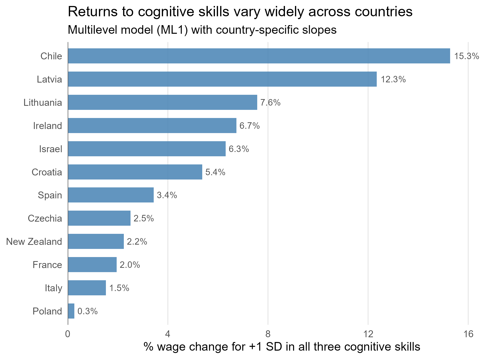

# Predicting wages across OECD countries

**A multilevel analysis using cross-national adult skills data (PIAAC Cycle 2)**

MSc thesis in Analytics and Data Science for Economics and Management, University of Brescia (2026). Author: Gabriele Ferraresi.

How much do cognitive skills and personality traits explain wages, how much do their returns differ across countries, and does a multilevel model actually predict better than OLS or regularized regression? This repository contains the full R pipeline used to answer these three questions on **26,336 employees in 12 countries**.



## Research questions

| | Question |
|---|---|
| **RQ1** | How much do directly measured cognitive skills and Big Five personality traits add to wage prediction, beyond standard human-capital and demographic controls? |
| **RQ2** | How much do the returns to skills and personality vary across countries? |
| **RQ3** | Given the hierarchical structure of the data, does a multilevel model predict wages out of sample better than OLS and regularized estimators (Ridge, LASSO, Elastic Net)? |

## Data

- **Source:** OECD [PIAAC Cycle 2](https://www.oecd.org/en/about/programmes/piaac/piaac-data.html) Public Use File (survey 2022–2023, released December 2024). It is the first PIAAC round that measures **cognitive skills** (literacy, numeracy, adaptive problem solving) and **Big Five personality traits** for the same individuals.
- **Outcome:** log hourly wage, converted to 2022 USD at purchasing power parity.
- **Sample:** 12 countries with complete wage and control data (Chile, Croatia, Czechia, France, Ireland, Israel, Italy, Latvia, Lithuania, New Zealand, Poland, Spain); 80/20 train/test split stratified by country (21,074 / 5,262).
- The microdata are **not included**: see [`data/README.md`](data/README.md) to download them.

## Methods

- **Nested specifications** (S0 controls only → S1 + cognitive skills → S2 + Big Five → S3 both), each evaluated **out of sample** (RMSE, MAE, R²) with bootstrap confidence intervals.
- **Estimators compared at equal information:** OLS, Ridge, LASSO and Elastic Net (`glmnet`, cross-validated λ and α), and **multilevel models** with country-specific random slopes (`lme4`).
- **Survey-specific robustness:** all 10 plausible values combined with Rubin's rules, three weighting schemes, HC3 standard errors, and leave-one-country-out re-estimation.

## Key results

- **RQ1.** Skills and personality both improve prediction, but modestly: together they raise out-of-sample R² by **0.015** over a baseline that already explains about half of the wage variance (0.499 → 0.514). Cognitive skills contribute roughly **three times** as much as the Big Five; numeracy is the strongest skill, extraversion and emotional stability the most rewarded traits.
- **RQ2.** Returns differ substantially across countries: a one-SD increase in all three skills is worth about **15% in Chile** and **12% in Latvia**, but **almost nothing in Poland** (figure above). The variation is confirmed by both the multilevel model and a joint test on OLS, and does not depend on any single country.
- **RQ3.** At equal information, the multilevel model **does not predict better** than OLS or the regularized estimators (test RMSE ≈ 0.359 for all of them). What improves accuracy is the *specification*, i.e. letting returns vary by country, whatever the estimator. The case for multilevel modelling here is interpretability of cross-country heterogeneity, not predictive accuracy.

| Model (country-specific returns) | Test RMSE | Test R² |
|---|---|---|
| OLS | 0.3587 | 0.521 |
| Ridge | 0.3592 | 0.520 |
| LASSO | 0.3588 | 0.520 |
| Elastic Net | 0.3588 | 0.521 |
| Multilevel (random slopes) | 0.3589 | 0.520 |

## Repository structure

```
├── R/
│   ├── 00_variable_blocks.R     # shared definition of predictor blocks
│   ├── 01_data_cleaning.R       # cleaning, PPP conversion, train/test split
│   ├── 02_descriptives.R        # descriptive statistics
│   ├── 03_ols_assumptions.R     # OLS diagnostics, VIF, HC3 standard errors
│   ├── 04_rq1_specifications.R  # RQ1: nested specifications
│   ├── 05_rq1_pv_weights.R      # RQ1 robustness: plausible values, weights
│   ├── 06_rq3_regularized.R     # RQ3: Ridge, LASSO, Elastic Net
│   ├── 07_multilevel.R          # RQ2-RQ3: multilevel models
│   └── 08_rq2_sensitivity.R     # RQ2 robustness: leave-one-country-out
├── output/
│   ├── tables/                  # all result tables (CSV)
│   └── figures/
├── data/README.md               # how to obtain the PIAAC data
└── run_all.R                    # runs the whole pipeline in order
```

## How to run

1. Install R (≥ 4.2) and the packages:
   ```r
   install.packages(c("tidyverse", "caret", "lmtest", "car", "lme4", "sandwich", "glmnet"))
   ```
2. Download the data and save `data/raw/PIAAC_Cycle2.rds` as described in [`data/README.md`](data/README.md).
3. From the repository root:
   ```r
   source("run_all.R")
   ```
   Tables are written to `output/tables/` and figures to `output/figures/`. The train/test split uses `set.seed(42)`.
